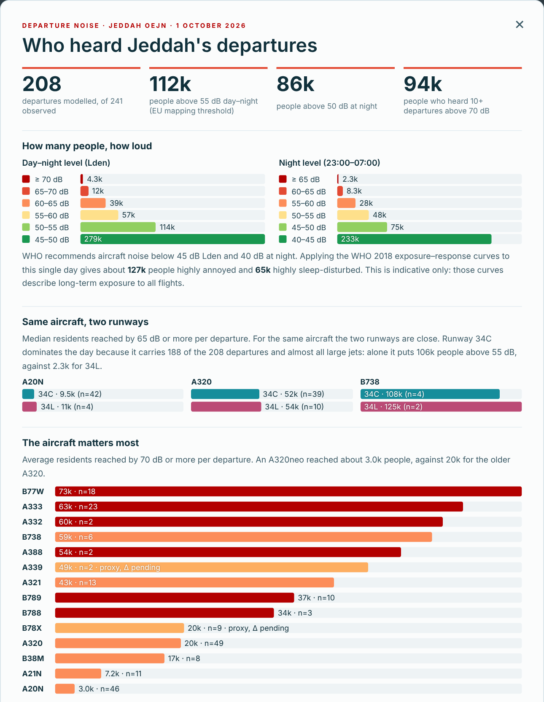

# OEJN Departure Noise & Population Exposure

Noise of the **observed jet departures** from King Abdulaziz International Airport, Jeddah (OEJN, runways 34C / 34L), on
**1 October 2026**, and the number of residents exposed. The noise is computed with **ECAC Doc 29, 5th Edition**.
Part of the SANS research *OEJN Noise–Fuel–Capacity* (layers A5 aircraft-noise data and A6 population).

## Results: 1 Oct 2026

**208 of 241** observed jet departures were modelled. The other 33 are listed with the reason in the results file.

| Indicator | Residents exposed |
|---|---:|
| Day–night level **Lden ≥ 55 dB** | **112,000** |
| Day–night level **Lden ≥ 65 dB** | **16,100** |
| Night level **Lnight ≥ 50 dB** | **86,000** |
| **≥ 10 loud events per day** (LAmax ≥ 70 dB, N70) | **94,000** |
| WHO 2018, indicative: highly annoyed / highly sleep-disturbed | 127,000 / 65,000 |

Full tables: [`docs/noise/results_2026-10-01.md`](docs/noise/results_2026-10-01.md).

## Key findings

1. **The noise falls on the city north of the airport.** All departures leave towards the north (runways 34). The loud zone
   follows the extended centreline over Abhur and the northern coast.
   - **Around 112k residents** are above the EU mapping threshold (Lden 55 dB), from a single day of departures alone.
   - **Around 505k residents** are above the WHO guideline (Lden 45 dB).
2. **Night flights carry a large share of the burden.**
   - **60 of the 208 departures** flew between 23:00 and 07:00.
   - With the +10 dB night weighting, **86k people** are above Lnight 50 dB.
   - **65k residents** are indicatively highly sleep-disturbed.
   - The timing of departures is therefore a noise lever, not only the routes.
3. **The runway itself is not the issue; the traffic split is.**
   - **For the same aircraft type, 34C and 34L expose similar numbers of residents per departure.** For example, an A320
     exposes about 52k vs 54k residents at LAmax ≥ 65 dB.
   - **34C carried 188 of the 208 departures**, including almost all widebodies. On its own, 34C puts 106k people above
     Lden 55 dB; 34L puts 2.3k.
   - **Swapping runways would change little.** Spreading the traffic, or changing which aircraft use which runway, would
     change more.
4. **The aircraft type matters most.**
   - **Per departure,** about 3k residents hear ≥ 70 dB from an A320neo, against about 20k from an older A320. Large twins
     (B77W, A333) reach 60–73k.
   - **Caveat:** this ranking depends on the aircraft substitution in A5. Most engines are unknown, so the conservative Doc 29
     variant is used. The ranking should be confirmed once engine types are resolved.
5. **Per-procedure (SID) comparison is not yet possible.**
   - Most A2 departures are unmatched or ambiguous to a SID, so this run supports **runway-level and aircraft-level**
     conclusions only.
   - This is the main input still needed for the noise–fuel–capacity trade-off.

## How the noise is computed

The Doc 29 segmentation method is fed with the **flown ADS-B trajectories**, as Doc 29 §3.6.1 allows: positions, heights,
speeds and bank angles come from the data. Only engine power is calculated.

**1 · Engine power:** corrected net thrust per engine (App. B, Eq. B-9)

$$\frac{F_n}{\delta} = E + F\,V_C + G_a\,h + G_b\,h^2 + H\,T$$

- $V_C$ is the calibrated airspeed, $h$ the pressure altitude and $T$ the air temperature.
- $E \ldots H$ are the ANP coefficients of the aircraft.
- Take-off thrust applies up to the cut-back height; climb thrust applies above it.

**2 · Segment level at a receptor** (Eq. 4-8, 4-9)

$$L_{E,seg} = L_E(P,d) + \Delta_V + \Delta_I(\varphi) - \Lambda(\beta,\ell) + \Delta_F + \Delta_{SOR}$$

$$L_{max,seg} = L_{max}(P,d) + \Delta_I(\varphi) - \Lambda(\beta,\ell) + \Delta_{SOR}$$

| Term | Meaning |
|---|---|
| $L(P,d)$ | NPD level for power $P$ at distance $d$ (EASA ANP 2.3), adjusted for the day's weather (App. D) |
| $\Delta_V = 10\lg(V_{ref}/V)$ | duration correction ($V_{ref}$ = 160 kt) |
| $\Delta_I$, $\Lambda$ | engine installation, lateral attenuation |
| $\Delta_F$, $\Delta_{SOR}$ | finite segment, start-of-roll directivity |

**3 · One departure**

$$SEL = 10\lg\sum_{seg}10^{L_{E,seg}/10} \qquad L_{Amax} = \max_{seg} L_{max,seg}$$

**4 · The day** (EU END; local time; $T_0$ = 1 s)

$$L_{den} = 10\lg\left[\frac{T_0}{86400}\left(\sum_{day}10^{SEL/10} + \sum_{eve}10^{(SEL+5)/10} + \sum_{night}10^{(SEL+10)/10}\right)\right]$$

- The periods are day 07–19 h, evening 19–23 h (+5 dB) and night 23–07 h (+10 dB).
- **Lnight** is the energy average over the night hours, without the penalty.
- **N70** is the number of departures with $L_{Amax}$ ≥ 70 dB.

**5 · Population:** levels are computed on a 250 m grid (80 × 80 km) and interpolated to the 100 m WorldPop 2026 cells
(3.8 M residents).

**Verification:**
- All Doc 29 Vol 3 reference cases are reproduced: 3,516 segments within 0.0014 dB, and end-to-end within 0.05 dB.
- 50 automated tests pass.
- Full method: [`docs/noise/methodology_noise.md`](docs/noise/methodology_noise.md).

## 3D map

**`map3d/OEJN_Map3D_Noise.html`:** download it and open it in Chrome or Edge. It is the team's Map 2 with a noise layer:

- the noise surface (Lden, Lnight, N70) in green → red;
- typical flight paths in 3D;
- residents per noise band;
- a Results panel;
- an illustrative **Live** mode, where the noise follows the aircraft during playback.

Details: [`map3d/README.md`](map3d/README.md).

## Limitations

- **Scope:** departures only, on a single day. Arrivals and ground noise are not included. The results are not annual or
  regulatory contours.
- **Assumptions:** full take-off thrust, which is conservative near the runway; roll starting at the threshold; flat terrain.
- **Aircraft identity:**
  - 25 flights have no aircraft type, so they are not modelled;
  - 11 use a proxy aircraft with Δ = 0, because certified levels are pending.

## Data sources

- **Aircraft noise:** EASA ANP 2.3 and ECAC Doc 29.
- **Population:** WorldPop 2026 (CC BY 4.0).
- **Basemap:** OpenStreetMap (ODbL) and Natural Earth.
- **Trajectories and runways:** ADS-B from Wingbits via the team's **A2** stage (raw tracks not included); runway
  thresholds and OpenStreetMap layers from **A1**.
- **Aircraft identity** (ICAO24 → type / engine): OpenSky aircraft database, with adsbdb.com as fallback. This is
  not the team's A3 stage: A3 is OpenAP (fuel / performance) and is not used for noise.
- **Weather:** OEJN METAR (Iowa Environmental Mesonet).
