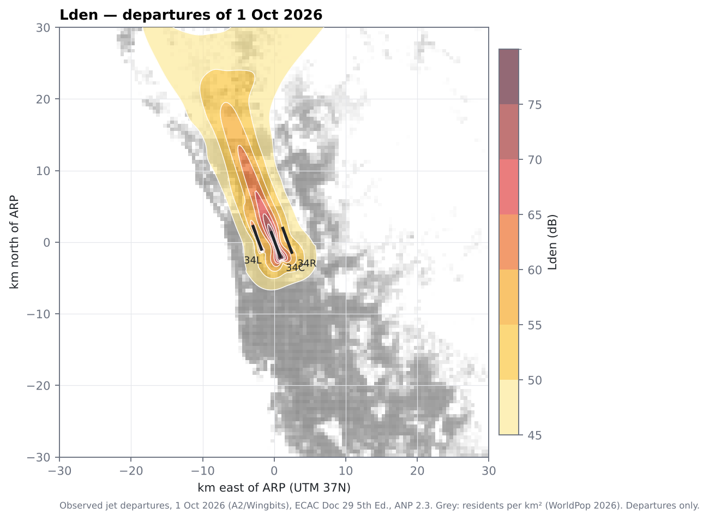
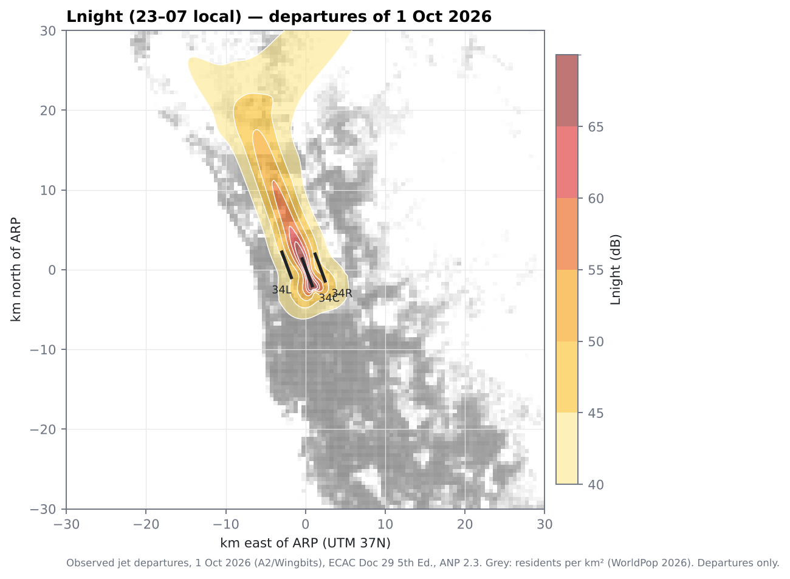
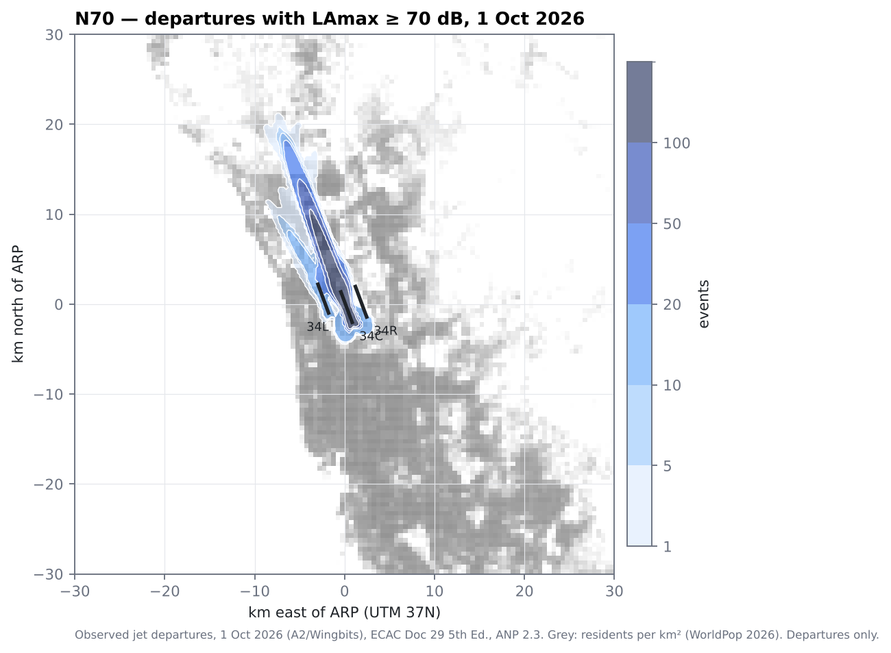
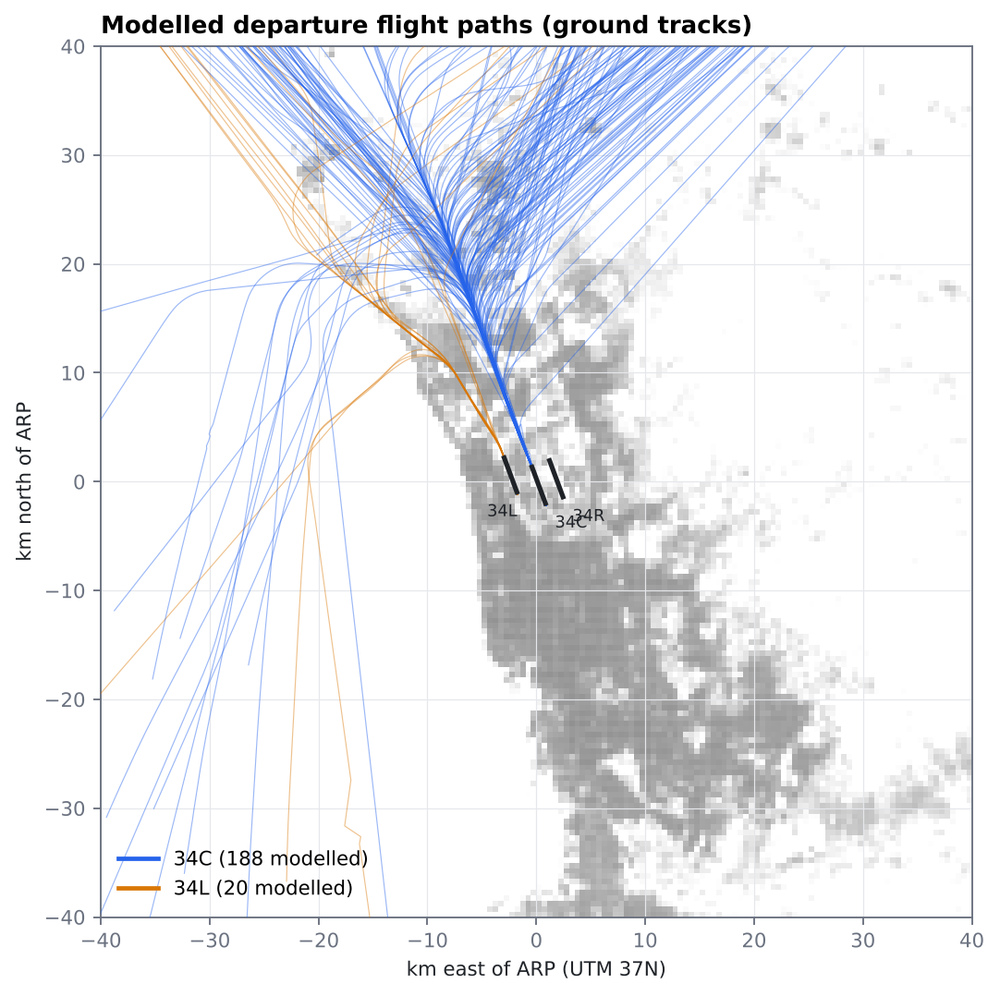
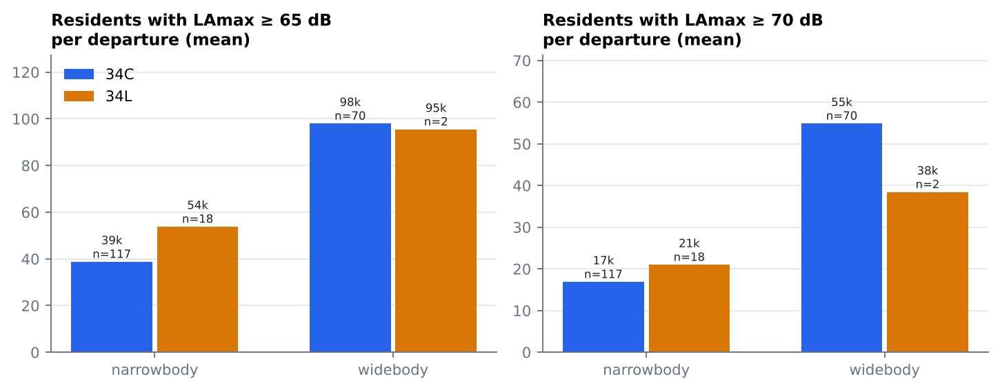

# Noise results — observed OEJN departures, 1 October 2026

Release `noise-doc29e5-oejn-2026-10-01-v1` · run 2026-10-29T21:42:29+00:00 · runtime 1117 s · method: [methodology_noise.md](methodology_noise.md)

> **Departures only, one day.** No arrivals, ground noise or other days. Full take-off thrust assumed. The values describe this day's departure noise; they are not annual or regulatory contours.

## Coverage

| A2 events | accepted departures (in scope) | modelled | no aircraft type | type not mappable (helicopter / piston / CL61) | path failed |
|---|---|---|---|---|---|
| 872 | 241 | **208** | 25 | 5 | 3 |

Modelled by runway: 34C 188, 34L 20. 11 departures (B78X, A339) use an ANP proxy with Δ = 0 dB (certified levels pending). Local periods: day 96, evening 52, night 60.

## Residents exposed (A6 WorldPop 2026, 3.8 M people inside the 80 × 80 km grid)

| Indicator | ≥ 45 | ≥ 50 | ≥ 55 | ≥ 60 | ≥ 65 | ≥ 70 | ≥ 75 |
|---|---|---|---|---|---|---|---|
| Lden (dB) | 505,024 | 226,005 | 111,933 | 54,701 | 16,135 | 4,263 | 811 |
| Lnight (dB) | 161,741 | 86,463 | 38,544 | 10,594 | 2,292 | – | – |

| Number-above (events in the day) | ≥ 1 | ≥ 5 | ≥ 10 | ≥ 20 | ≥ 50 | ≥ 100 |
|---|---|---|---|---|---|---|
| N60 | 638,624 | 473,397 | 415,432 | 208,047 | 143,516 | 94,191 |
| N65 | 379,970 | 231,710 | 179,586 | 116,050 | 87,700 | 54,645 |
| N70 | 195,695 | 110,063 | 94,047 | 69,791 | 48,461 | 22,734 |

WHO 2018 exposure–response (indicative only; designed for long-term exposure to all operations): 126,565 highly annoyed, 65,134 highly sleep-disturbed.

## Per departure, by runway and aircraft class (mean residents)

| Runway | Class | Departures | LAmax ≥ 60 | LAmax ≥ 65 | LAmax ≥ 70 | SEL ≥ 80 |
|---|---|---|---|---|---|---|
| 34C | business jet | 1 | 54,211 | 16,165 | 4,211 | 3,799 |
| 34C | narrowbody | 117 | 77,174 | 38,781 | 16,883 | 23,784 |
| 34C | widebody | 70 | 183,075 | 97,980 | 54,877 | 70,938 |
| 34L | narrowbody | 18 | 108,143 | 53,839 | 20,998 | 32,511 |
| 34L | widebody | 2 | 180,201 | 95,494 | 38,443 | 49,524 |

Compare runways within a class: the fleet mix differs (widebodies use 34C almost exclusively). 34L has few departures this day (n small), so the comparison is indicative.

**Same aircraft type on both runways** (median residents per departure; types with ≥ 2 departures on each runway):

| Type | 34C n | 34C LAmax ≥ 65 | 34C LAmax ≥ 70 | 34L n | 34L LAmax ≥ 65 | 34L LAmax ≥ 70 |
|---|---|---|---|---|---|---|
| A20N | 42 | 9,493 | 2,870 | 4 | 11,465 | 4,671 |
| A320 | 39 | 52,467 | 20,816 | 10 | 54,065 | 16,420 |
| B738 | 4 | 107,770 | 56,425 | 2 | 124,926 | 61,552 |

Within a type the two runways expose similar numbers of residents per departure; the class-level gap above comes mostly from the fleet mix (more A320ceo / B737 on 34L, more A320neo on 34C). The aircraft type matters more than the runway on this day: e.g. A320 vs A20N medians differ several-fold. That type effect rests on the A5 substitution (engines unknown for most airframes: A320 -> ANP A320-211 +0.2 dB, A20N -> A320-232 -3.5 dB, Doc 29 conservative variant), so it should be confirmed once engine types are resolved.

Runway contribution to the day's Lden (each runway's departures alone):

| Runway | Lden ≥ 45 | ≥ 55 | ≥ 65 |
|---|---|---|---|
| 34C | 483,557 | 105,639 | 15,911 |
| 34L | 38,290 | 2,302 | 199 |

## Aircraft types modelled

| ICAO type | Departures | ANP proxy | Δ (dB) | Mapping | mean residents LAmax ≥ 70 |
|---|---|---|---|---|---|
| A320 | 49 | A320-211 | +0.2 | EASA_ICAO_AMBIGUOUS | 19,517 |
| A20N | 46 | A320-232 | -3.5 | EASA_ICAO_AMBIGUOUS | 3,034 |
| A333 | 23 | A330-301 | +2.0 | EASA_ICAO_AMBIGUOUS | 63,474 |
| B77W | 18 | 7773ER | +0.0 | EASA_ICAO | 72,645 |
| A321 | 13 | A321-232 | +3.5 | EASA_ICAO | 43,389 |
| A21N | 11 | A321-232 | -3.7 | EASA_ICAO | 7,190 |
| B789 | 10 | 7878R | +3.2 | EASA_ICAO | 37,200 |
| B78X | 9 | 7878R | +0.0 | ANALYST_PROXY_PENDING | 20,035 |
| B38M | 8 | 7378MAX | +0.2 | EASA_ICAO | 16,971 |
| B738 | 6 | 737800 | +0.6 | EASA_ICAO | 58,666 |
| B788 | 3 | 7878R | +3.1 | EASA_ICAO | 34,104 |
| A332 | 2 | A330-301 | +2.0 | EASA_ICAO_AMBIGUOUS | 60,370 |
| A339 | 2 | A330-343 | +0.0 | ANALYST_PROXY_PENDING | 48,734 |
| A388 | 2 | A380-861 | +0.3 | EASA_ICAO_AMBIGUOUS | 53,820 |
| B737 | 1 | 737700 | +1.5 | EASA_ICAO | 65,050 |
| A359 | 1 | A350-941 | +0.2 | EASA_ICAO | 19,576 |
| B77L | 1 | 7773ER | -0.2 | EASA_ICAO | 64,489 |
| B744 | 1 | 747400 | +0.0 | EASA_ICAO | 86,192 |
| B739 | 1 | 737800 | +1.2 | EASA_ICAO | 61,419 |
| CL60 | 1 | CL601 | +0.8 | EASA_ICAO | 4,211 |

## QC

| Check | Status | Detail |
|---|---|---|
| inputs.metar | PASS | METAR rows: 36 |
| inputs.aircraft_identity | PASS | A3 identity rows: 339 |
| grid.interpolation_error | PASS | flight OEJN-2026-10-01-70605e-1790848015838: bilinear grid->receptor vs exact at 2000 populated receptors with LAmax >= 50 dB: SEL /err/ p50 0.00 / p95 0.06 dB; LAmax /err/ p50 0.00 / p95 0.16 dB; mean signed SEL err +0.00 dB |
| path.height_sources | PASS | geometric-height share (median over flights) 0.99; median per-flight (geometric - baro) height difference +120 ft (p95 /./ 187 ft) |
| path.flags | WARNING | flights with path flags: 3; liftoff_clamped_min; liftoff_speed_from_first_climb_point; observation_gap_max_192s |
| coverage.modelled | WARNING | 208 of 241 in-scope departures modelled; status counts {'OK': 197, 'NO_TYPE': 25, 'PROXY_ZERO_DELTA': 11, 'UNMAPPED': 5, 'PATH_FAILED': 3} |
| weather.fallback | PASS | 0 modelled flights used the weather fallback |
| grid.border_level | PASS | max LAeq,24h on the grid border 37.4 dB (grid large enough when well below the lowest reported band) |
| population.in_grid | PASS | A6 population inside the noise grid: 3,801,835 on 215561 receptors |

## Figures

